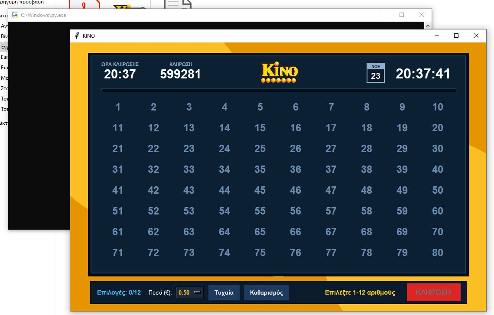
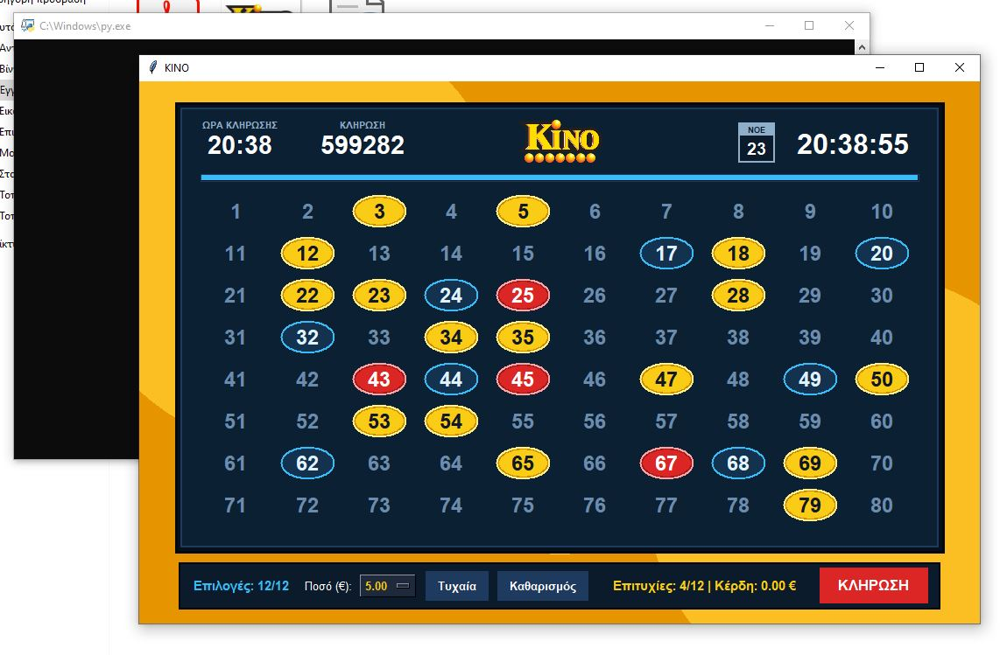

<div align="center">
  
  <h1>Προσομοίωση Παιχνιδιού ΚΙΝΟ (Python / Tkinter)</h1>
  <p>
    Διαδραστική desktop εφαρμογή προσομοίωσης του παιχνιδιού <strong>ΚΙΝΟ</strong> με γραφικό περιβάλλον χρήστη (GUI) αναπτυγμένη σε Python.
  </p>

  
  
  
</div>

---

## Περιεχόμενα

- [Περιγραφή](#περιγραφή)
- [Στιγμιότυπα Οθόνης](#στιγμιότυπα-οθόνης)
- [Βασικές Λειτουργίες](#βασικές-λειτουργίες)
- [Κανόνες Παιχνιδιού & Τρόπος Λειτουργίας](#κανόνες-παιχνιδιού--τρόπος-λειτουργίας)
- [Πίνακας Αποδόσεων](#πίνακας-αποδόσεων)
- [Δομή Αποθετηρίου](#δομή-αποθετηρίου)
- [Απαιτήσεις & Εγκατάσταση](#απαιτήσεις--εγκατάσταση)
- [Τεκμηρίωση](#τεκμηρίωση)
- [Δημιουργός](#δημιουργός)

---

## Περιγραφή

Το **paixnidi_kino-Python** είναι μια προσομοίωση του δημοφιλούς αριθμοπαιχνιδιού **ΚΙΝΟ**, γραμμένη εξ ολοκλήρου σε **Python** με χρήση της βιβλιοθήκης **Tkinter**. Η εφαρμογή επιτρέπει στον χρήστη να αλληλεπιδρά μέσω γραφικού περιβάλλοντος, να επιλέγει αριθμούς, να ορίζει το ποντάρισμά του και να παρακολουθεί σε πραγματικό χρόνο την κλήρωση και τον υπολογισμό των κερδών.

---

## Στιγμιότυπα Οθόνης

| Κύρια Οθόνη Παιχνιδιού | Οθόνη Κλήρωσης / Αποτελεσμάτων |
| :---: | :---: |
|  |  |

---

## Βασικές Λειτουργίες

- **Γραφικό Περιβάλλον (GUI):** Κατασκευασμένο με `Tkinter` και προσαρμοσμένα γραφικά (`kino.png`).
- **Διαδραστικό Δελτίο Αριθμών:** Επιλογή και αποεπιλογή αριθμών από το 1 έως το 80.
- **Διαχείριση Πονταρίσματος & Υπολοίπου:** Επιλογή ποσού συμμετοχής και αυτόματη ενημέρωση υπολοίπου/κερδών *(προσαρμόστε ανάλογα με τις επιλογές του κώδικα)*.
- **Προσομοίωση Κλήρωσης:** Τυχαία κλήρωση 20 αριθμών και οπτική επισήμανση των επιτυχιών.
- **Αναλυτική Τεκμηρίωση:** Συνοδεύεται από το αρχείο [`epexigisi_programmatos_kino.pdf`](epexigisi_programmatos_kino.pdf) με την επεξήγηση του αλγορίθμου.

---

## Κανόνες Παιχνιδιού & Τρόπος Λειτουργίας

1. **Επιλογή Αριθμών:** Ο παίκτης επιλέγει από **1 έως 12 αριθμούς** (από το σύνολο των 80 αριθμών του δελτίου).
2. **Ορισμός Πονταρίσματος:** Επιλέγεται το ποσό πονταρίσματος ανά κλήρωση.
3. **Κλήρωση:** Το σύστημα κληρώνει τυχαία **20 μοναδικούς αριθμούς** από το 1 έως το 80.
4. **Υπολογισμός Επιτυχιών:** Συγκρίνονται οι επιλεγμένοι αριθμοί με τους κληρωθέντες και υπολογίζονται τα κέρδη βάσει του πίνακα αποδόσεων.

---

## Πίνακας Αποδόσεων

*(Σημείωση: Συμπληρώστε/επιβεβαιώστε τους ακριβείς συντελεστές που έχετε ορίσει μέσα στο `ΚΙΝΟ.py`)*

| Επιλεγμένοι Αριθμοί | Επιτυχίες | Συντελεστής Απόδοσης |
| :---: | :---: | :---: |
| **1** | 1 | `x2.5` |
| **2** | 2 | `x5` |
| **3** | 2 / 3 | `x2.5` / `x25` |
| **4** | 2 / 3 / 4 | `x1` / `x4` / `x100` |
| **5** | 3 / 4 / 5 | `x2` / `x20` / `x450` |
| ... | ... | ... |

---

## Δομή Αποθετηρίου

```text
paixnidi_kino-Python/
├── ΚΙΝΟ.py                         # Κύριος πηγαίος κώδικας της εφαρμογής
├── kino.png                        # Εικονίδιο / λογότυπο εφαρμογής
├── Kino-screenshot1.JPG            # Στιγμιότυπο οθόνης 1
├── Kino-screenshot2.JPG            # Στιγμιότυπο οθόνης 2
├── epexigisi_programmatos_kino.pdf # Αναλυτική επεξήγηση λειτουργίας του προγράμματος
└── README.md                       # Τεκμηρίωση αποθετηρίου
```

---

## Απαιτήσεις & Εγκατάσταση

### Προαπαιτούμενα
- **Python 3.x**
- **Tkinter** (περιλαμβάνεται στην τυπική εγκατάσταση της Python)
- *(Προσθέστε τυχόν εξωτερικές βιβλιοθήκες αν χρησιμοποιούνται, π.χ. `Pillow`)*

### Βήματα Εκτέλεσης

1. **Κλωνοποιήστε το αποθετήριο:**
   ```bash
   git clone https://github.com
   cd paixnidi_kino-Python
   ```

2. **Εγκαταστήστε τυχόν εξαρτήσεις (εφόσον απαιτούνται):**
   ```bash
   pip install pillow
   ```

3. **Εκτελέστε την εφαρμογή:**
   ```bash
   python ΚΙΝΟ.py
   ```
   *(Σε Linux/macOS ενδέχεται να χρειαστεί `python3 ΚΙΝΟ.py`)*

---

## Τεκμηρίωση

Για αναλυτική περιγραφή της δομής του προγράμματος, των συναρτήσεων και της ροής εκτέλεσης, ανατρέξτε στο αρχείο [epexigisi_programmatos_kino.pdf](epexigisi_programmatos_kino.pdf).

---

## Δημιουργός

- **Lefteris Channas** – [@lefterischannas-wq](https://github.com)
